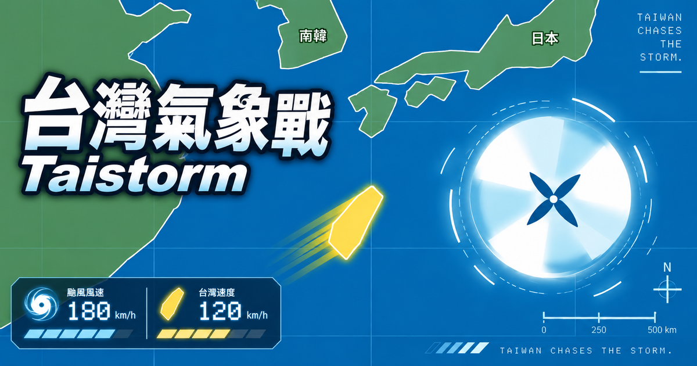

[README.md](https://github.com/user-attachments/files/35497263/README.md)
# 🌪️ 台灣氣象戰 | Taistorm

**你就是颱風。** 在海上發展、登陸台灣累積分數，但小心——台灣會離開原本的位置，反過來追著你跑！

🎮 **[立即免費遊玩 Taistorm](https://nonightcream.github.io/Taistorm/)**

## 🎮 遊戲玩法

- **海上發展**：在海洋上恢復颱風強度。
- **登陸刷分**：在陸地上持續得分，但颱風也會逐漸衰弱。
- **躲避台灣**：台灣會主動追逐颱風；被台灣碰到就有危險！
- **挑戰紀錄**：努力撐得更久，取得更高分數。

## 🌪️ 四種玩法

遊戲開始前可以自由搭配「高速模式」與「雙颱模式」兩項追加模式：

| 玩法 | 設定 | 特色 |
| --- | --- | --- |
| 一般模式 | 不啟用追加模式 | 單颱風生存挑戰 |
| 高速模式 | 啟用高速模式 | 更刺激的高速追逐 |
| 雙颱模式 | 啟用雙颱模式 | 兩名玩家共同逃離台灣追擊 |
| 雙颱高速模式 | 同時啟用高速與雙颱 | 雙人合作的高速生存挑戰 |

雙颱模式加入倒地、復活等機制，讓兩名玩家能互相支援。

## 🕹️ 操作方式

| 模式 | 操作 |
| --- | --- |
| 單颱模式（電腦） | 使用滑鼠移動颱風 |
| 雙颱模式（電腦） | 玩家 1：滑鼠移動；玩家 2：**W / A / S / D** 移動，**Space** 衝刺 |
| 手機／觸控裝置 | 使用遊戲內的觸控操作 |

> 雙颱模式與雙颱高速模式的遊戲畫面中，也會顯示 WASD 操作提示。

## ✨ v1.2.0 更新重點

- 新增雙颱模式與雙颱高速玩法。
- 雙颱模式支援雙人操作、倒地與復活。
- 加入相關音效、遊戲迷因及操作提示。
- 調整鍵盤移動速度平衡。
- 優化颱風資訊面板及多語言介面。

## 🌐 語言與平台

- 語言：繁體中文、English、日本語。
- 平台：網頁瀏覽器；支援電腦與行動裝置操作。
- 無需下載安裝，直接開啟遊戲網址即可遊玩。

## 👤 製作者

**無夜霜（Nonightcream）**

- X：[@nonightcream](https://x.com/nonightcream)
- 遊戲：[Taistorm](https://nonightcream.github.io/Taistorm/)

---

*Taistorm v1.2.0 · 一款以台灣與颱風為主題的網頁小遊戲。*
